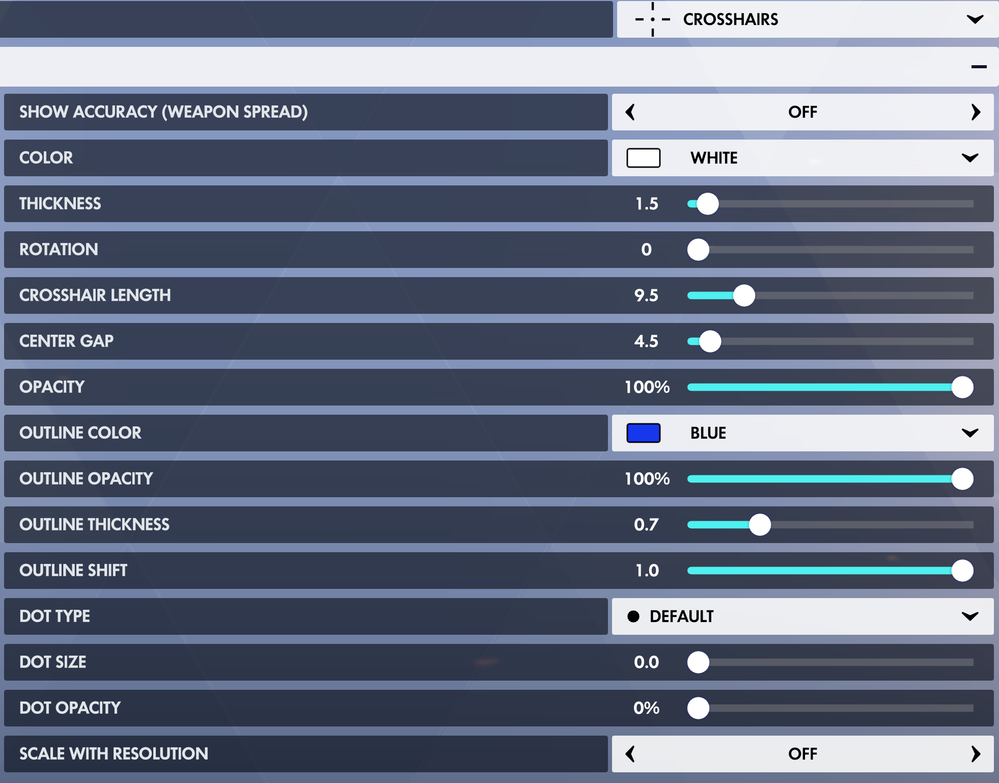
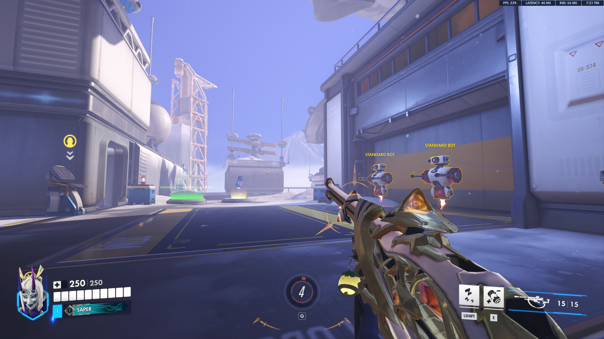
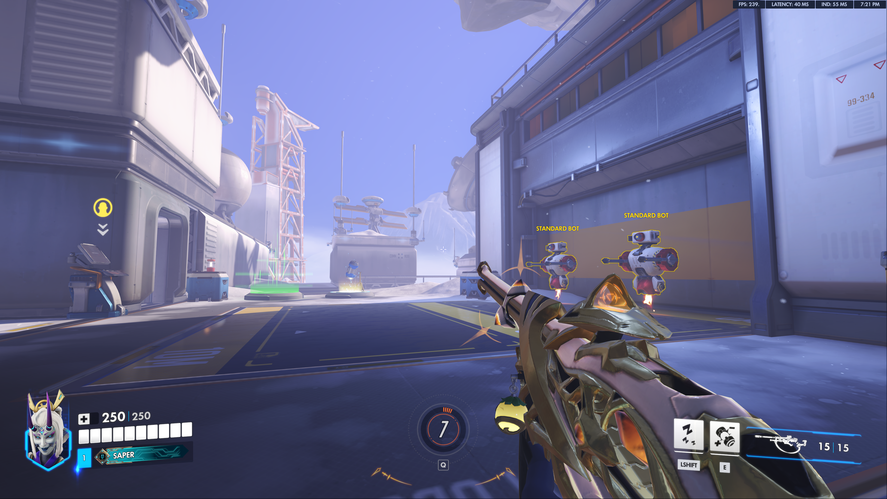

# Overwatch Clearer Crosshairs

[English](#english) | [繁體中文](#繁體中文)

## Crosshair Showcase / 準心展示

**Settings / 準心設定**

| Before / 調整前 (19:21:01) | After / 調整後 (19:21:15) |
|:--:|:--:|
|  |  |

[View full showcase / 查看完整展示頁](SHOWCASE.md)

## English

A lightweight Windows utility that changes crosshair pixel alignment in **Overwatch 2** on 4K displays.

> **Important trade-off — the sharpness is swapped, not universally improved.**
> - **Before:** Even-pixel-width crosshairs are generally sharper; odd-pixel-width crosshairs may look blurry.
> - **After:** Odd-pixel-width crosshairs can become sharper; previously sharp even-pixel-width crosshairs can become blurry.
>
> Results depend on in-game crosshair settings, rendering, and the display setup.

### How it works

On a **3840×2160** desktop, the utility changes the game's client area to **3839×2159** and removes window borders. It dynamically manages always-on-top behavior so the game can cover the taskbar while still allowing Alt+Tab. Your Windows desktop resolution remains unchanged.

### Use

1. Download and extract the ZIP from [Releases](../../releases). Keep both scripts in the same folder.
2. Start Overwatch 2 in **Windowed** or **Borderless Windowed** mode. **Exclusive Fullscreen is not supported.**
3. Double-click `Start_Overwatch_Crosshair_Offset.vbs`.
4. Press **F10** to stop and restore the original window.

### Limitations and safety

- Designed and tested for a **3840×2160** desktop; the target client size is fixed at **3839×2159**.
- Odd/even sharpness is a **trade-off**, not a universal enhancement.
- Other overlays or window managers may interfere with Alt+Tab or window positioning.
- Uses PowerShell and Windows window APIs; does not intentionally modify game files or inject code into the game process.
- Unofficial community utility, not affiliated with Blizzard. **Anti-cheat compatibility has not been officially confirmed.** Use at your own discretion.

## 繁體中文

這是一款適用於 4K 螢幕的輕量 Windows 工具，透過調整《**Overwatch 2（鬥陣特攻 2）**》的視窗尺寸，改變準心的像素對齊方式。

> **重要取捨：這是清晰度的互換，不是所有準心一起變清晰。**
> - **使用前：** 偶數像素寬度的準心通常較清晰；奇數像素寬度可能模糊。
> - **使用後：** 奇數像素寬度的準心可能變清晰；原本清晰的偶數像素寬度準心則可能變模糊。
>
> 實際效果也會受到遊戲內準心設定、渲染方式及顯示環境影響。

### 運作方式

在 **3840×2160** 的桌面上，將遊戲的客戶區域調整為 **3839×2159** 並移除視窗邊框。工具會動態調整置頂狀態，讓遊戲覆蓋工作列且仍能使用 Alt+Tab，**不會改變 Windows 桌面解析度**。

### 使用方法

1. 從 [Releases（發行版本）](../../releases) 下載 ZIP 並解壓縮，兩個腳本需放在同一資料夾。
2. 啟動 Overwatch 2，使用**視窗化**或**無邊框視窗化**。**不支援獨佔全螢幕。**
3. 雙擊 `Start_Overwatch_Crosshair_Offset.vbs`。
4. 按 **F10** 停止工具並還原原本視窗。

### 限制與注意事項

- 目前針對 **3840×2160** 桌面設計與測試；遊戲客戶區域固定為 **3839×2159**。
- 奇數與偶數寬度準心的清晰度是**互換取捨**，不是全面改善。
- 其他疊加工具或視窗管理軟體可能影響 Alt+Tab 與視窗位置。
- 透過 PowerShell 與 Windows 視窗 API 運作；不刻意修改遊戲檔案或向遊戲程序注入程式碼。
- 本工具是非官方社群作品，與 Blizzard（暴雪）無關；**未經官方確認反作弊相容性**，請自行評估使用風險。

## License / 授權

This project is licensed under the GNU General Public License v3.0. See [LICENSE](LICENSE). / 本專案採用 GNU General Public License v3.0（GNU 通用公共授權條款第 3 版），詳見 [LICENSE](LICENSE)。
